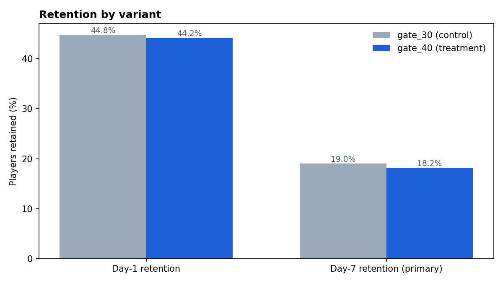
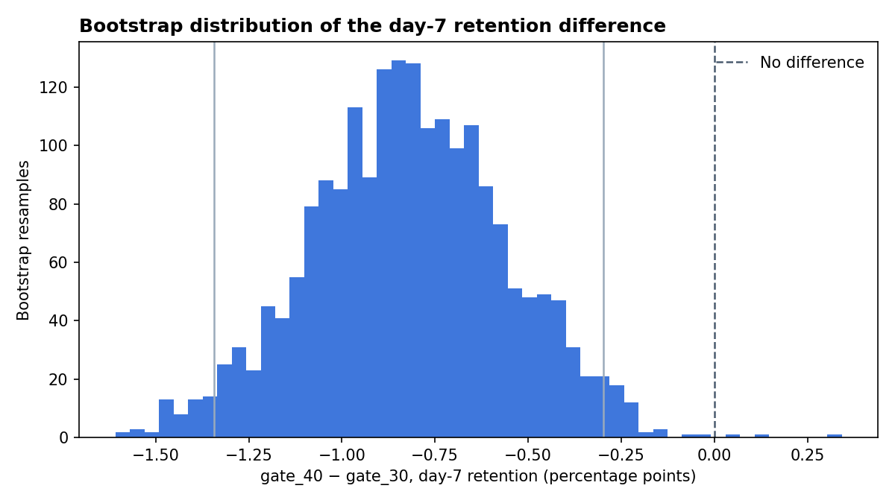
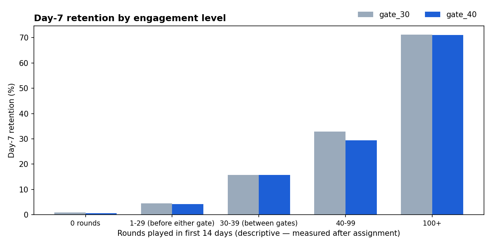

# A/B Test Readout — Does Moving a Progression Gate Hurt Player Retention?

[](https://github.com/abatista346/ab-test-retention/actions/workflows/tests.yml)

> End-to-end experiment analysis in SQL (DuckDB) and Python: data-quality and sample-ratio checks, a pre-declared primary metric, two-proportion tests with confidence intervals, multiple-testing correction, bootstrap robustness checks, power analysis, and a written ship/no-ship recommendation.

## Problem

In the mobile puzzle game *Cookie Cats*, players hit a "gate" that forces them to wait or pay before continuing. The product team tested moving the first gate from **level 30** to **level 40**. A later gate could feel friendlier — or it could remove a natural break that keeps players coming back.

**Decision to make:** keep the gate at level 30, or move it to level 40?

## Data Source

Cookie Cats A/B test dataset, published on Kaggle — about 90k players randomly assigned to `gate_30` (control) or `gate_40` (treatment), with rounds played in their first 14 days and whether they returned 1 and 7 days after install. Not included in this repository; see [Setup](#setup).

| Column | Meaning |
|---|---|
| `userid` | Player identifier |
| `version` | `gate_30` (control) or `gate_40` (treatment) |
| `sum_gamerounds` | Rounds played in the first 14 days after install |
| `retention_1` / `retention_7` | Did the player come back 1 / 7 days after install? |

## Analysis Plan (decided before looking at results)

| Element | Choice | Why |
|---|---|---|
| Primary metric | Day-7 retention | Long-term engagement is what the gate placement is meant to protect |
| Secondary metric | Day-1 retention | Early signal; corrected for multiple comparisons with Holm |
| Guardrail | Rounds played | Heavy-tailed, so Mann-Whitney U plus a bootstrap CI on the p99-capped mean |
| Validity check | Sample-ratio mismatch (χ² vs. 50/50) | A broken split invalidates everything downstream |
| Significance | α = 0.05, two-sided | Standard; reported alongside confidence intervals, not instead of them |
| Power | Minimum detectable effect at 80% power | Lets a null result be read as "no effect larger than X" |

## Approach

1. **SQL layer** (`sql/`, executed with DuckDB) — data-quality checks (duplicates, invalid values, outliers), per-variant summary, and an engagement-level breakdown.
2. **Statistics** (`src/analyze.py`) — SRM test, two-proportion z-tests with Newcombe confidence intervals, Holm correction, bootstrap check of the primary metric, non-parametric engagement test, and power analysis.
3. **Readout** — the script writes the *Results* section below from the computed numbers, so the README never drifts from the code.

## Tech Stack

SQL (DuckDB), Python, pandas, SciPy, statsmodels, matplotlib

<!-- RESULTS:START -->

## Results

**Decision:** **Keep the gate at level 30.** Moving it to level 40 lowers 7-day retention by 0.82 pp (-4.3% relative; 95% CI -1.33 to -0.31 pp), and the result survives multiple-testing correction and a bootstrap check that makes no normality assumption.

| Check | gate_30 | gate_40 | Difference (95% CI) | p (Holm) |
|---|---|---|---|---|
| Sample ratio (SRM, χ² vs 50/50) | 44,700 | 45,489 | control share 49.56% | p = 0.009 |
| **Day-7 retention (primary)** | 19.02% | 18.20% | -0.82 pp (-1.33 to -0.31) | 0.0031 |
| Day-1 retention | 44.82% | 44.23% | -0.59 pp (-1.24 to 0.06) | 0.0744 |
| Rounds played, capped at p99 (guardrail) | 49.1 | 48.9 | -1.3 to +0.9 rounds | Mann-Whitney p = 0.050 |

- **Sample ratio**: the split is 49.56% / 50.44% (χ² p = 0.009). That clears the standard SRM alarm threshold of p < 0.001, but it is not a perfect 50/50; in production I would confirm with the logging team that no players were dropped from one arm before relying on the result. The imbalance is small next to the effect: re-weighting the arms to 50/50 would not change the retention rates themselves, which are computed within each arm.
- **Robustness**: the bootstrap 95% interval for the day-7 difference is -1.34 to -0.30 pp, and 99.9% of resamples fall below zero.
- **Sensitivity**: at 80% power and α = 0.05 this sample detects absolute changes of ~0.74 pp in day-7 and ~0.93 pp in day-1 retention.




### Where the effect comes from (descriptive)

Rounds played is measured *after* assignment, so splitting by it is not a randomized comparison — the gate itself can change who ends up in each bucket. The chart is useful to see *where* retention diverges, not to estimate a causal effect within a bucket.



<!-- RESULTS:END -->

## Architecture

```
sql/
  01_data_quality.sql        <- duplicates, invalid values, outliers
  02_variant_summary.sql     <- per-variant sample sizes and rates
  03_engagement_segments.sql <- day-7 retention by engagement bucket
src/
  ingest.py                  <- downloads the dataset into data/raw/
  analyze.py                 <- runs the SQL, the statistics, the charts and the README section
outputs/
  figures/                   <- exported charts
  results.json               <- every computed number
```

## Setup

1. `pip install -r requirements.txt`
2. `python src/ingest.py` (or download the Cookie Cats CSV from Kaggle into `data/raw/cookie_cats.csv`)
3. `python src/analyze.py`

Run the test suite with `pip install pytest && pytest` — it uses synthetic data, so no dataset download is needed.

## Limitations and Next Steps

1. **Retention is not revenue.** A later gate may change how many players pay to skip it; the decision should be confirmed against in-app purchase data, which this dataset does not include.
2. **Sequential testing.** This readout assumes a fixed-horizon test analyzed once. If results were monitored daily, a sequential method (e.g. alpha spending) would be needed to keep the false-positive rate at 5%.
3. **Variance reduction.** With pre-experiment engagement data, CUPED could shrink the confidence intervals and the required sample size.
